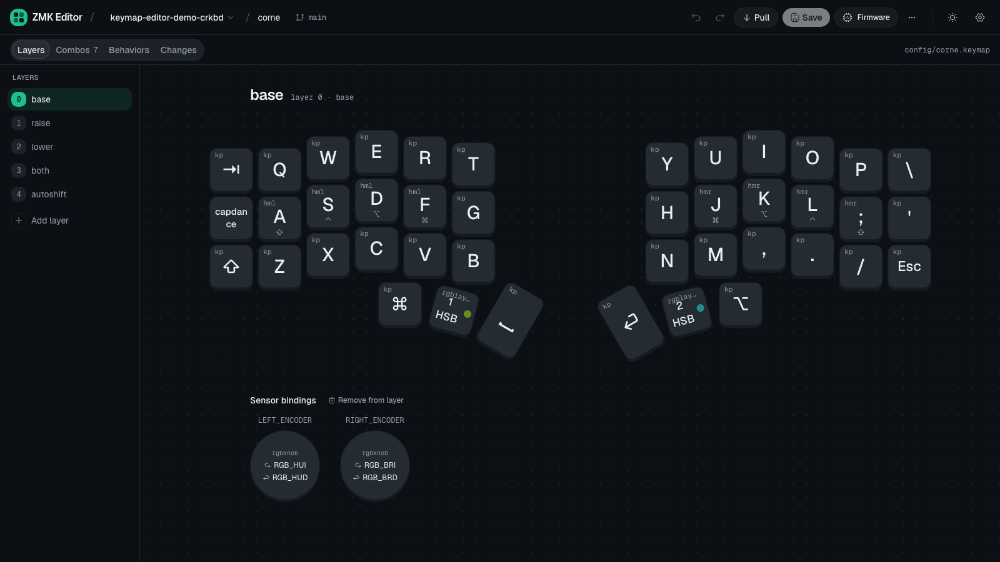

# ZMK Editor

A visual editor for [ZMK](https://zmk.dev) keymaps that runs on your own machine as a single executable. It works directly on your zmk-config **git repositories**: edit layers and combos, commit and push, then download or flash the firmware that GitHub Actions built.



## Based on keymap-editor

ZMK Editor is a successor to [**keymap-editor**](https://github.com/nickcoutsos/keymap-editor) by [Nick Coutsos](https://github.com/nickcoutsos), the browser-based ZMK keymap editor that many ZMK users relied on. Its source is no longer being updated, so this project carries the idea forward.

It keeps the core of how keymap-editor looks and works: the layer list on the left, the keyboard drawn from its physical layout with rotated keys, a small behavior tag and a big legend on every key, encoders under the keyboard, and keymap-editor's layout JSON format.

What changes:

| keymap-editor | ZMK Editor |
| --- | --- |
| Hosted web app with a GitHub App integration | Local app, one executable, your data stays on your machine |
| One GitHub repository at a time through the GitHub API | Any number of repositories, cloned over SSH/HTTPS or used in place, with real `git` (pull, push, branches, diff) |
| Firmware builds are out of scope | Lists GitHub Actions builds, downloads artifacts, flashes `.uf2` files to a keyboard in bootloader mode |
| JavaScript (Node + React) | Go backend with an embedded React frontend |

ZMK Editor is a new implementation and does not reuse keymap-editor's source code. Credit for the concept and design goes to keymap-editor; see [THIRD_PARTY_NOTICES.md](THIRD_PARTY_NOTICES.md).

## Features

- **Works on your repositories.** Add as many zmk-config repositories as you like: clone over SSH or HTTPS, or open a checkout you already have. Git runs with your own keys, credentials and identity.
- **Edits the `.keymap` file itself.** Only the bindings, names and combos you change are rewritten. Comments, formatting, includes, macros and behavior definitions stay exactly as they were, and a save that changes nothing leaves the file byte-for-byte identical.
- **Layers.** Add, rename, duplicate and delete layers. Click a key to change it: searchable pickers for every behavior and keycode, modifier chips (`LC(LS(A))`), press-a-key capture, layer names instead of numbers, hold/tap legends, colour swatches for `RGB_COLOR_HSB(...)`, encoder (sensor) bindings.
- **Combos.** Click keys on the keyboard to set the positions, then pick the binding, layers, timeout and other options.
- **Your own behaviors.** Hold-taps, macros, tap-dances and mod-morphs defined in the keymap show up in the pickers with the right parameters.
- **Physical layouts** from a layout JSON next to the keymap (keymap-editor / QMK `info.json` style), a ZMK `zmk,physical-layout` anywhere in the repository, a layout you paste in, or a grid generated from the keymap itself.
- **Never edit a stale keymap.** Opening a repository fetches from the remote and, if there are new commits, shows them and offers to pull first.
- **Git built in.** Diff, commit, commit and push, pull (fast-forward or rebase), fetch, switch and create branches, discard changes.
- **Firmware.** See the GitHub Actions builds of your branch, download artifacts, save `.uf2` files, or copy one straight onto a keyboard in bootloader mode. Trigger a new build from the app.
- Undo/redo, ⌘S / Ctrl+S to save, dark and light themes.


## Getting started

### Build

Requires Go 1.26 and Node 24 (see `.tool-versions`).

```bash
git clone git@github.com:ArekX/zmk-editor.git
cd zmk-editor
make build
./bin/zmk-editor
```

The editor opens in your browser at `http://127.0.0.1:7373` (or the next free port). Cross-compiled binaries for macOS, Linux and Windows:

```bash
make release   # -> bin/release/
```

### Requirements at runtime

- `git` on your PATH. Repositories are cloned and pushed with your normal git setup, so SSH keys and credential helpers work as they do in a terminal.
- For firmware downloads: a GitHub token with read access to Actions (add it in Settings), or a logged-in [GitHub CLI](https://cli.github.com) (`gh auth login`), which the editor picks up automatically. GitHub requires a token to download artifacts, even from public repositories.

### Options

| flag | default | |
| --- | --- | --- |
| `--addr` | `127.0.0.1:7373` | listen address; walks forward if the port is taken |
| `--data-dir` | `~/.zmk-editor` | database, managed clones and firmware cache (also `ZMK_EDITOR_DATA_DIR`) |
| `--no-browser` | off | do not open the browser on start |

The server only listens on loopback and only answers requests addressed to `localhost`, `127.0.0.1` or `[::1]`.

## How it works

1. **Add a repository** on the start page. The editor finds the `.keymap` files in it (those under `config/` first).
2. **Edit** layers and combos. Changes stay in the editor until you save; undo and redo work across all of them.
3. **Save** writes the changes into the `.keymap` file in the working tree. If the file changed on disk since you opened it (a pull, another editor), the save is refused instead of overwriting it.
4. **Commit and push** from the Changes tab, where you can review the diff first.
5. **Get the firmware** from the Firmware panel once GitHub Actions has built your push: download it, or flash it straight to a keyboard half that is in bootloader mode.

### Physical layouts

To draw your keyboard, the editor looks for, in order: a custom layout you pasted in (Physical layout in the `...` menu), a `<keymap name>.json` or `info.json` next to the keymap, a `zmk,physical-layout` devicetree node in the repository, and otherwise a grid built from the line structure of your first layer. Layout JSON uses keymap-editor's format:

```json
{
  "layouts": {
    "LAYOUT": {
      "layout": [
        { "row": 0, "col": 0, "x": 0, "y": 0.36 },
        { "row": 3, "col": 5, "x": 3.48, "y": 2.63, "r": 30, "rx": 3.98, "ry": 7.88, "h": 1.5 }
      ]
    }
  },
  "sensors": [{ "label": "LEFT_ENCODER" }]
}
```

When keys have `row` and `col`, saved bindings are aligned in the file to match them.

## Limitations

- Keymaps whose layers are generated by C preprocessor macros (for example zmk-helpers `ZMK_LAYER(...)`) open with a notice and cannot be edited. Object-like `#define`s (`#define NAV 1`, `#define ___ &trans`) are understood.
- Existing layers cannot be reordered, and deleting a layer does not renumber `&mo N` style references (the editor warns you).
- Behavior and macro definitions are shown read-only.

## Development

```bash
make dev     # Go backend + Vite dev server with hot reload
make check   # Go build/vet/test/gofmt + frontend typecheck/lint/build
```

- Backend: Go, stdlib `net/http`, SQLite (`modernc.org/sqlite`, no CGO), the `git` CLI. Code in [internal/](internal/), entry point in [cmd/zmk-editor](cmd/zmk-editor/).
- Frontend: React 19, TypeScript, Vite, Tailwind CSS v4, shadcn/ui, TanStack Query, in [frontend/zmk-editor-ui](frontend/zmk-editor-ui/), embedded into the binary at build time.
- Design docs are in [spec/](spec/README.md), the decision log in [decisions/](decisions/), and contributor conventions in [CLAUDE.md](CLAUDE.md).

## License

[MIT](LICENSE). Third-party credits and licenses are in [THIRD_PARTY_NOTICES.md](THIRD_PARTY_NOTICES.md).
