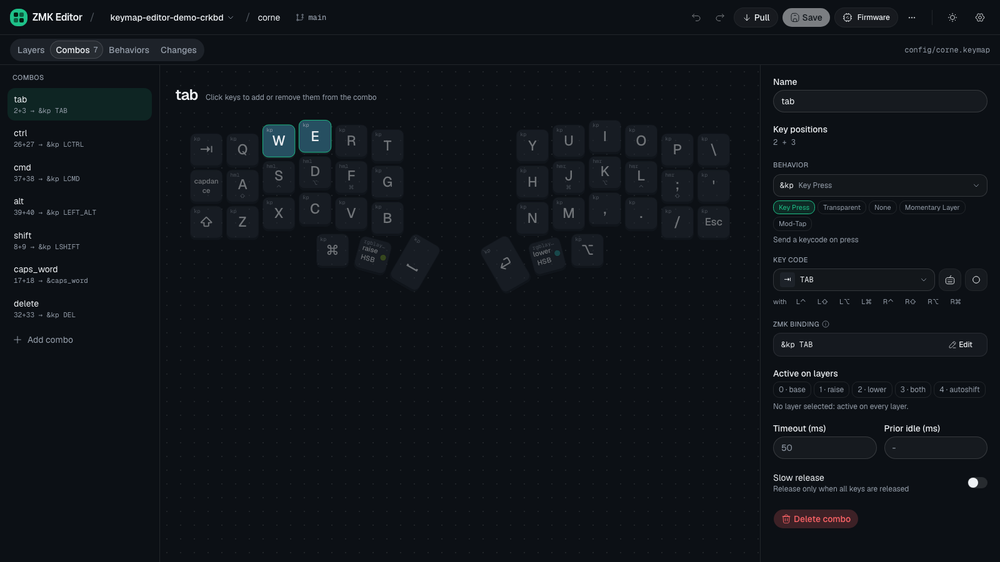
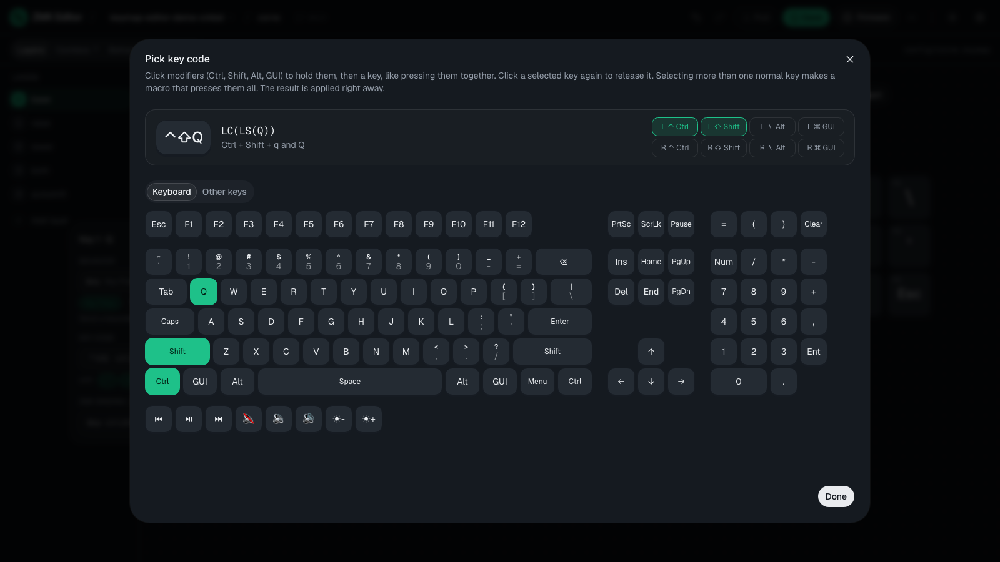
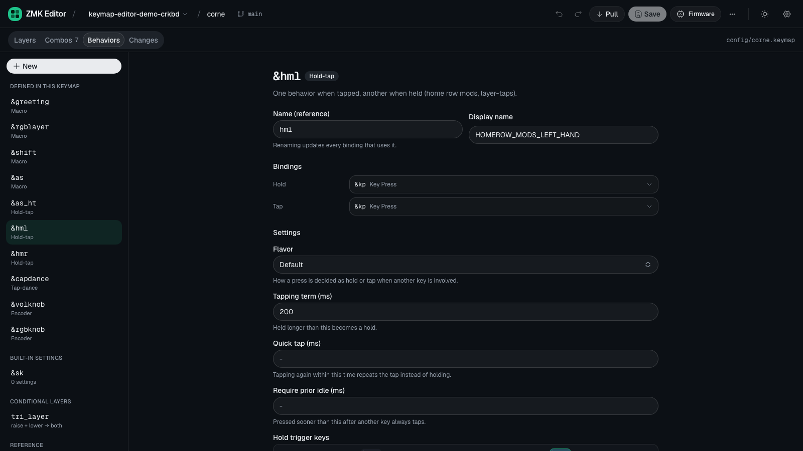

# ZMK Editor

A visual editor for [ZMK](https://zmk.dev) keymaps that runs on your own machine as a single executable. It works directly on your zmk-config **git repositories**: edit layers and combos, commit and push, then flash the firmware GitHub Actions built straight onto your keyboard over USB, all from the app.


## Based on keymap-editor

ZMK Editor is a successor to [**keymap-editor**](https://github.com/nickcoutsos/keymap-editor) by [Nick Coutsos](https://github.com/nickcoutsos), the browser-based ZMK keymap editor that many ZMK users relied on. Its source is no longer being updated, so this project carries the idea forward.

It keeps the core of how keymap-editor looks and works: the layer list on the left, the keyboard drawn from its physical layout with rotated keys, a small behavior tag and a big legend on every key, encoders under the keyboard, and keymap-editor's layout JSON format.

ZMK Editor is a new implementation and does not reuse keymap-editor's source code. Credit for the concept and design goes to keymap-editor; see [THIRD_PARTY_NOTICES.md](THIRD_PARTY_NOTICES.md).

## Features

- **Works on your repositories.** Add as many zmk-config repositories as you like: clone over SSH or HTTPS, or open a checkout you already have. Git runs with your own keys, credentials and identity.
- **Edits the `.keymap` file itself.** Only the bindings, names and combos you change are rewritten. Comments, formatting, includes, macros and behavior definitions stay exactly as they were, and a save that changes nothing leaves the file byte-for-byte identical.
- **Layers.** Add, rename, duplicate, delete and reorder layers (drag them); references such as `&mo 2`, layer-taps, combo layers, conditional layers and `#define NAV 2` are renumbered for you. Layer names instead of numbers, hold/tap legends, symbols on keycaps (`!`, `@`, `#` rather than `EXCL`, `AT`, `HASH`), colour swatches for `RGB_COLOR_HSB(...)`, encoder (sensor) bindings.
- **Pick keys the easy way.** Click a key to change it, then:
  - pick on a full-size keyboard (with numpad and media keys) where Ctrl, Shift, Alt and GUI work like real modifiers: Ctrl + Shift + A becomes `LC(LS(A))`;
  - find every other ZMK key code (F13-F24, international, media, app launch keys, ...) on the "Other keys" tab, with a filter;
  - search the dropdown, or press the key or key combination on your own keyboard to capture it;
  - select several normal keys at once to make a macro that presses them together;
  - hold keys take modifier combinations too (`&mt LS(LCTRL) A`).
  The five behaviors you used last sit under the behavior picker as shortcuts. The ZMK binding field shows the exact devicetree text and can be edited directly; it is checked before it is applied.
- **Move keys around.** Swap keys, even across layers: turn on Swap keys and click pairs, it stays on until you stop it. Drag a key onto another to swap it (⌥ to copy), select several keys with Shift or ⌘ and set them at once, copy and paste with ⌘C / ⌘V or the Copy and Paste buttons, and revert a changed key to how it was (a swapped key reverts together with its partner).
- **Combos.** Click keys on the keyboard to set the positions, then pick the binding, layers, timeout and other options.
- **Behaviors and macros.** Create and edit hold-taps (flavor, tapping term, quick tap, positional hold-trigger keys picked on the keyboard, ...), mod-morphs, tap-dances, sticky keys and macros, including macros that take parameters. Change the settings of built-ins such as `&mt` or `&sk`. Renaming a behavior updates every key that uses it.
- **Conditional layers** (tri-layer): create and edit them.
- **Physical layouts** from a layout JSON next to the keymap (keymap-editor / QMK `info.json` style), a ZMK `zmk,physical-layout` in the repository, the layout of the keyboard in ZMK itself (80 keyboards built in), the repository's matrix transform, a layout you paste in, or a grid generated from the keymap.
- **Export** a layer or the whole keymap as SVG or PNG.
- **Build checks.** After a save the editor warns about things that would break the firmware build (unknown behaviors, wrong parameter counts, layers out of range).
- **Never edit a stale keymap.** Opening a repository fetches from the remote and, if there are new commits, shows them and offers to pull first.
- **Git built in.** Diff, commit, commit and push, pull (fast-forward or rebase), fetch, switch and create branches, discard changes. After saving, a Push button in the top bar commits (message prefilled) and pushes in one step.
- **Firmware.** See the GitHub Actions builds of your branch, download artifacts, save `.uf2` files, and trigger a new build from the app.
- **Easy flashing over USB.** Connect the keyboard (or one half) with a USB cable and put it in bootloader mode (usually a double tap on reset). The app detects the bootloader drive; click Flash next to the `.uf2` for that half and it is copied onto the keyboard, which restarts with the new firmware. No downloading, unzipping or dragging files in a file manager.
- Undo/redo, ⌘S / Ctrl+S to save, dark and light themes.







## Getting started

### Build

Requires Go 1.26 and Node 24 (see `.tool-versions`).

```bash
git clone git@github.com:ArekX/zmk-editor.git
cd zmk-editor
make build
./bin/zmk-editor
```

The editor opens in your browser at `http://127.0.0.1:7373` (or the next free port). Cross-compiled binaries for macOS, Linux and Windows:

```bash
make release   # -> bin/release/
```

### Requirements at runtime

- `git` on your PATH. Repositories are cloned and pushed with your normal git setup, so SSH keys and credential helpers work as they do in a terminal.
- For firmware downloads: a GitHub token with read access to Actions (add it in Settings), or a logged-in [GitHub CLI](https://cli.github.com) (`gh auth login`), which the editor picks up automatically. GitHub requires a token to download artifacts, even from public repositories.

### Options

| flag | default | |
| --- | --- | --- |
| `--addr` | `127.0.0.1:7373` | listen address; walks forward if the port is taken |
| `--data-dir` | `~/.zmk-editor` | database, managed clones and firmware cache (also `ZMK_EDITOR_DATA_DIR`) |
| `--no-browser` | off | do not open the browser on start |

The server only listens on loopback and only answers requests addressed to `localhost`, `127.0.0.1` or `[::1]`.

## How it works

1. **Add a repository** on the start page. The editor finds the `.keymap` files in it (those under `config/` first).
2. **Edit** layers, combos and behaviors. Changes stay in the editor until you save; undo and redo work across all of them.
3. **Save** writes the changes into the `.keymap` file in the working tree. If the file changed on disk since you opened it (a pull, another editor), the save is refused instead of overwriting it.
4. **Commit and push** with the Push button in the top bar, or from the Changes tab, where you can review the diff first.
5. **Flash the firmware** from the Firmware panel once GitHub Actions has built your push: connect a keyboard half over USB, double-tap reset to enter the bootloader, and click Flash next to that half's `.uf2`. Repeat for the other half. You can also just download the files.

### Physical layouts

To draw your keyboard, the editor looks for, in order: a custom layout you pasted in (Physical layout in the `...` menu), a `<keymap name>.json` or `info.json` next to the keymap, a `zmk,physical-layout` devicetree node in the repository, and otherwise a grid built from the line structure of your first layer. Layout JSON uses keymap-editor's format:

```json
{
  "layouts": {
    "LAYOUT": {
      "layout": [
        { "row": 0, "col": 0, "x": 0, "y": 0.36 },
        { "row": 3, "col": 5, "x": 3.48, "y": 2.63, "r": 30, "rx": 3.98, "ry": 7.88, "h": 1.5 }
      ]
    }
  },
  "sensors": [{ "label": "LEFT_ENCODER" }]
}
```

When keys have `row` and `col`, saved bindings are aligned in the file to match them.

## Limitations

- Keymaps whose layers or behaviors are generated by C preprocessor macros (for example zmk-helpers `ZMK_LAYER(...)`, `ZMK_HOLD_TAP(...)`) open with a notice and those parts cannot be edited. Object-like `#define`s (`#define NAV 1`, `#define ___ &trans`) are understood.
- Behaviors defined in other files (`#include "macros.dtsi"`) can be used on keys but are edited in their own file.
- Deleting a layer leaves references to that layer itself as they are (the editor tells you how many there are).

## Development

```bash
make dev     # Go backend + Vite dev server with hot reload
make check   # Go build/vet/test/gofmt + frontend typecheck/lint/build
```

- Backend: Go, stdlib `net/http`, SQLite (`modernc.org/sqlite`, no CGO), the `git` CLI. Code in [internal/](internal/), entry point in [cmd/zmk-editor](cmd/zmk-editor/).
- Frontend: React 19, TypeScript, Vite, Tailwind CSS v4, shadcn/ui, TanStack Query, in [frontend/zmk-editor-ui](frontend/zmk-editor-ui/), embedded into the binary at build time.
- Design docs are in [spec/](spec/README.md), the decision log in [decisions/](decisions/), and contributor conventions in [CLAUDE.md](CLAUDE.md).

## License

[MIT](LICENSE). Third-party credits and licenses are in [THIRD_PARTY_NOTICES.md](THIRD_PARTY_NOTICES.md).
